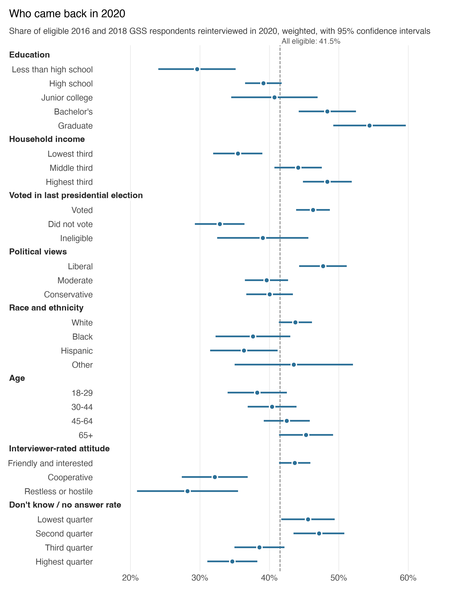
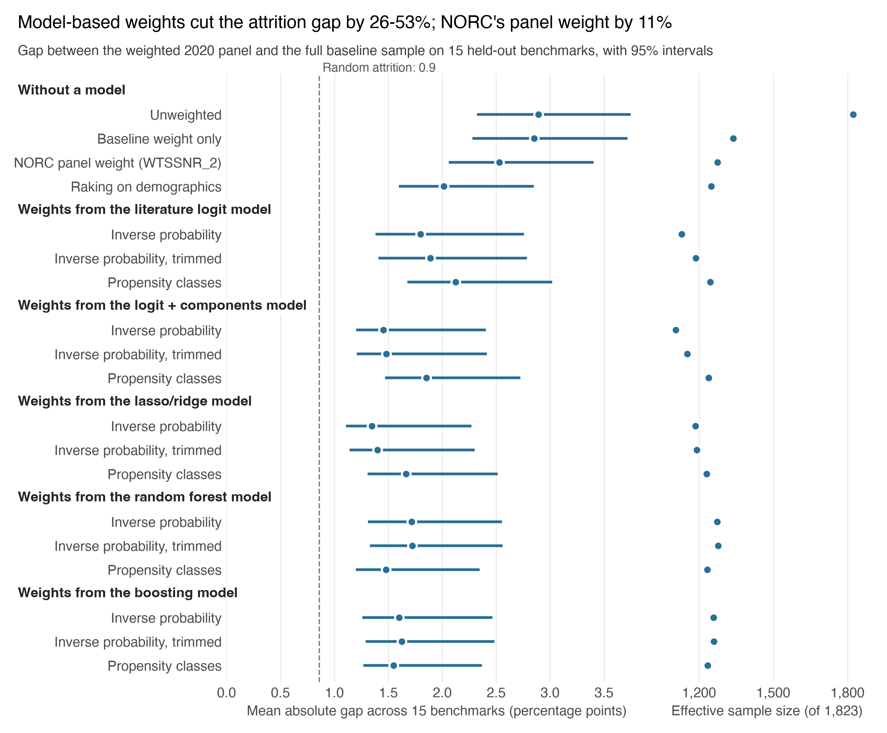
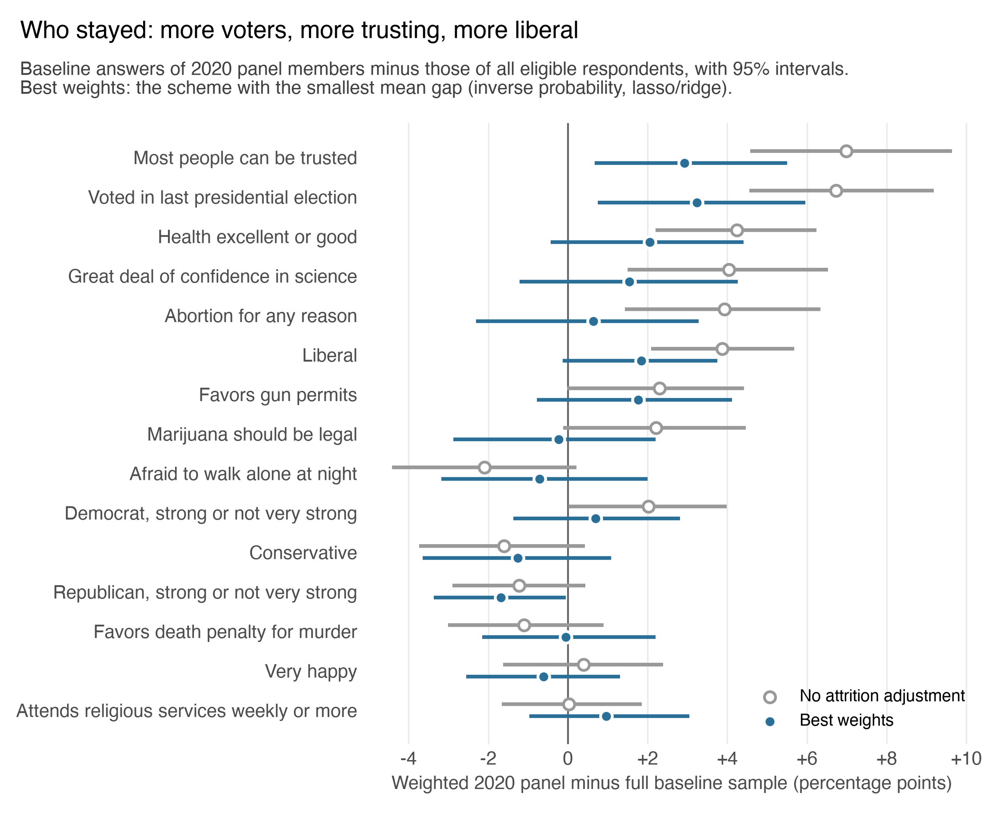
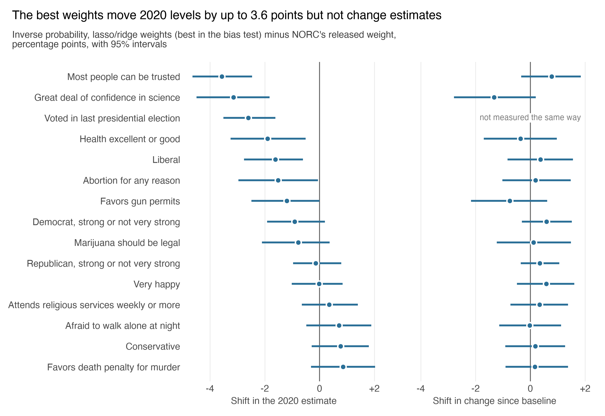

```{python}
import pandas as pd
from IPython.display import Markdown

T = "output/tables/"
checks = pd.read_csv(T + "codebook_checks.csv").set_index("check")
rates = pd.read_csv(T + "retention_by_group.csv").set_index(["characteristic", "group"])
then = pd.read_csv(T + "attrition_vs_2006_panels.csv").set_index(["characteristic", "group"])
models = pd.read_csv(T + "model_comparison.csv").set_index("model")
model_diff = pd.read_csv(T + "model_differences.csv").set_index("model")
bias = pd.read_csv(T + "bias_summary.csv").set_index("scheme")
vs = pd.read_csv(T + "bias_comparisons.csv").set_index(["scheme", "reference"])
gaps = pd.read_csv(T + "benchmark_gaps.csv").set_index(["scheme", "benchmark"])
est = pd.read_csv(T + "estimates_2020.csv").set_index(["measure", "scheme", "outcome"])

neg = lambda s: s.replace("-", "−")                         # typographic minus
num = lambda x, d=1: neg(f"{x:.{d}f}")
pct = lambda x, d=0: f"{x:.{d}f}%"
ci = lambda lo, hi, d=1: neg(f"{lo:.{d}f} to {hi:.{d}f}")

rate = lambda c, g: rates.loc[(c, g), "reinterviewed_pct"]
gap = lambda b, s="base": gaps.loc[(s, b), "gap"]
cut = lambda s: bias.loc[s, "reduction_vs_base_pct"]
models_ipw = [s for s in bias.index if s.startswith("ipw_") and not s.startswith("ipw_trim")]

def versus(scheme, reference, d=2):
    r = vs.loc[(scheme, reference)]
    return f"{num(r.difference, d)} points (95% interval {ci(r.ci_low, r.ci_high, d)})"

def lowered(outcome, scheme="ipw_penalized_logit", interval=False):
    """A downward shift from NORC's weight, stated as a positive number of points."""
    r = est.loc[("level", scheme, outcome)]
    out = num(-r.shift_vs_norc)
    return out + f" points (95% interval {ci(-r.shift_ci_high, -r.shift_ci_low)})" if interval else out

def level(outcome, scheme):
    return pct(est.loc[("level", scheme, outcome), "estimate"], 1)

shift_mean = lambda measure, scheme: (est.loc[(measure, scheme)]["shift_vs_norc"].abs().mean())
retention_overall = float(checks.loc["Weighted retention, overall (%)", "this_file"])
best = "ipw_penalized_logit"
```

## Summary

In 2020 the General Social Survey (GSS), run by NORC at the University of Chicago, tried to reinterview people it had first interviewed in 2016 or 2018. Only `{python} pct(retention_overall, 0)` of eligible respondents took part. NORC's released panel weight adjusts for that loss only by geographic area. I could find no published analysis of who left this panel.

I compare attrition weights from the standard logistic regression used in earlier GSS work to machine-learning methods (penalized regression, random forests, gradient boosting). I find penalized logistic regression produces weights that remove the most bias. Because the people who left the panel still have their full baseline interview in the data, the right answer is known for any question asked before anyone left, so I can check whether each set of weights makes the people who stayed look like everyone who started. Panel studies have long used this kind of check (Fitzgerald, Gottschalk, and Moffitt 1998); to my knowledge it has not been applied to this panel's weights.

**Weights from a model that uses the whole questionnaire cut the attrition bias roughly in half; NORC's released weight cuts it by about a tenth.**

1. **Model-based weights beat both NORC's weight and demographic raking.** Across 15 benchmark measures held out of every model, NORC's weight closes `{python} pct(cut("norc"))` of the gap, raking on demographics `{python} pct(cut("raking"))`, and weights from the five attrition models `{python} pct(min(cut(s) for s in models_ipw))`–`{python} pct(max(cut(s) for s in models_ipw))`.
2. **The panel kept more voters, more trusting people, and more liberals.** At baseline, the people who stayed were `{python} num(gap("trusts_people"))` points more likely than all eligible respondents to say most people can be trusted, `{python} num(gap("voted"))` points more likely to have voted, and `{python} num(gap("liberal"))` points more likely to call themselves liberal. Dropout tracked education much more steeply than in the GSS's 2006–2014 panels.
3. **The best predictor is not the best weight.** Random forests and gradient boosting ranked dropout best but removed less bias than penalized logistic regression. Choosing an attrition model by predictive accuracy alone would pick the wrong one.
4. **Better weights change 2020 estimates but not estimates of change.** Relative to NORC's weight, they lower the 2020 share who say most people can be trusted by `{python} lowered("trusts_people")` points and the share with a great deal of confidence in science by `{python} lowered("confidence_science")` points. Within-person change from baseline to 2020 barely moves under any weighting.

## Who left the panel

```{python}
invited = 4494
eligible = 4351
```

The 2016–2020 GSS Panel reinterviewed every 2018 respondent and a random three-quarters of 2016 respondents, `{python} f"{invited:,}"` people in all, from August to September 2020, mostly by web. After setting aside `{python} invited - eligible` who had died, moved abroad, or entered an institution, `{python} f"{eligible:,}"` were eligible and 1,823 completed the reinterview. Following Morgan and Lee's (2020) work on the GSS's earlier panels, I treat the eligible respondents as the population the weights should represent.

Who came back depended strongly on socioeconomic status and on how the baseline interview went. Among respondents without a high school diploma, `{python} pct(rate("Education", "Less than high school"))` were reinterviewed; among those with a graduate degree, `{python} pct(rate("Education", "Graduate"))`. Respondents who had voted in the previous presidential election came back at `{python} pct(rate("Voted in last presidential election", "Voted"))`, nonvoters at `{python} pct(rate("Voted in last presidential election", "Did not vote"))`. Respondents whom the baseline interviewer rated "friendly and interested" came back at `{python} pct(rate("Interviewer-rated attitude", "Friendly and interested"))`, those rated restless or hostile at `{python} pct(rate("Interviewer-rated attitude", "Restless or hostile"))`.

{width=85%}

The education gradient is much steeper than in the GSS's 2006–2014 face-to-face panels: a graduate degree lowered the chance of dropping out by `{python} num(-then.loc[("Education", "Graduate"), "gap_2016_2020"])` points relative to a high school diploma, against `{python} num(-then.loc[("Education", "Graduate"), "gap_2006_2014"])` points then (Morgan and Lee 2020). The designs differ (one web-first reinterview during the pandemic versus two face-to-face reinterviews), so the comparison describes the panels rather than isolating a cause.

## Predicting who left

I compared five models of who would be reinterviewed, each predicting from information collected at baseline:

- **Logistic regression with literature predictors:** about 20 predictors modeled on Morgan and Lee's attrition models for the earlier panels (demographics, a vocabulary test, interviewer traits, and the interviewer's ratings of the interview).
- **The same, plus principal components** of the other 355 questionnaire items, an unsupervised summary of respondents' attitudes and circumstances.
- **Penalized (lasso or ridge) logistic regression**, a **random forest**, and **gradient boosting**, each using every baseline item asked in both years.

The 15 benchmark measures, and every item from the same question batteries, were held out of all models so they could be used to test the weights. Every respondent's predicted probability comes from a model that never saw them (five-fold cross-validation, with tuning and preprocessing inside the training folds).

```{python}
rows = [{"Model": r.label, "AUC": f"{r.auc:.3f}", "Calibration slope": f"{r.calibration_slope:.2f}"}
        for _, r in models.iterrows()]
Markdown(pd.DataFrame(rows).to_markdown(index=False, disable_numparse=True))
```

*AUC: how well a model ranks stayers above leavers (0.5 is chance). Calibration slope: 1 means predicted probabilities match observed rates; below 1, they are too extreme.*

Dropout is only weakly predictable, as in the earlier panels (Frankel and Hillygus 2014; Morgan and Lee 2020). The tree models rank it best, improving AUC by `{python} f"{model_diff.loc['boosting', 'auc_difference']:.3f}"` over the literature logistic regression (95% interval `{python} f"{model_diff.loc['boosting', 'auc_ci_low']:.3f}"` to `{python} f"{model_diff.loc['boosting', 'auc_ci_high']:.3f}"` for boosting), and boosting's probabilities are the best calibrated.

## Do the weights remove bias?

Each model's probabilities become weights by inversion: a respondent the model gave a 25% chance of returning stands in for four people like them, one with a 50% chance for two. I compared these with NORC's released weight, with raking to the full sample's age, sex, race and ethnicity, education, region, and baseline year, and with no attrition adjustment. (Trimming the largest weights or grouping respondents into propensity classes made little difference or did worse; both are in the output tables.)

For each held-out benchmark, the target is its baseline value among all eligible respondents, and each weighting scheme estimates it from the 1,823 who stayed. The difference is the attrition bias: what attrition adds to the panel's estimate of a question asked before anyone left. (It is not error relative to the U.S. population, since the baseline sample has its own sampling error and nonresponse.) Even random attrition would leave an average gap of about `{python} num(bias.loc["random_attrition", "mean_abs_gap"])` points, because those who stayed are a 42% subsample. Intervals come from 1,000 bootstrap resamples of the survey's sampling units.

{width=100%}

Without attrition adjustment, the panel misses the baseline values by `{python} num(bias.loc["base", "mean_abs_gap"], 2)` points on average. NORC's weight lowers that to `{python} num(bias.loc["norc", "mean_abs_gap"], 2)`, a reduction its interval cannot distinguish from zero. Raking lowers it to `{python} num(bias.loc["raking", "mean_abs_gap"], 2)`. The penalized logistic regression on the full questionnaire does best, at `{python} num(bias.loc[best, "mean_abs_gap"], 2)`: `{python} versus(best, "norc")` relative to NORC's weight and `{python} versus(best, "raking")` relative to raking. Its weights cost little precision: an effective sample size (Kish 1965) of `{python} f"{bias.loc[best, 'effective_n']:,.0f}"`, against `{python} f"{bias.loc['norc', 'effective_n']:,.0f}"` for NORC's weight.

Neither ranking nor calibration decided which weights worked. Gradient boosting predicted dropout best and was best calibrated, yet removed less bias (`{python} num(bias.loc["ipw_boosting", "mean_abs_gap"], 2)`) than the penalized regression; adding principal components barely improved the literature model's predictions but cut its remaining bias from `{python} num(bias.loc["ipw_logit_literature", "mean_abs_gap"], 2)` to `{python} num(bias.loc["ipw_logit_pca", "mean_abs_gap"], 2)`. Weights reduce bias only to the extent that the attrition model captures characteristics related to the outcomes being estimated (Little and Vartivarian 2005). Here those are political and social attitudes, which the questionnaire-wide models see and the demographic and paradata predictors largely do not. Pew Research Center reached a similar conclusion when weighting online opt-in samples: adding political variables to demographic weighting reduced bias far more than any more complex statistical method did (Mercer, Lau, and Kennedy 2018).

{width=85%}

## What changes in 2020

The benchmark questions were asked again in 2020. There is no true 2020 value to check against, but the bias test indicates which direction is right.

{width=100%}

Relative to NORC's weight, the best weights lower the 2020 share who say most people can be trusted from `{python} level("trusts_people", "norc")` to `{python} level("trusts_people", best)`, the share with a great deal of confidence in science by `{python} lowered("confidence_science", interval=True)`, and the share who voted in 2016 by `{python} lowered("voted", interval=True)`. Across the 15 measures, levels move by `{python} num(shift_mean("level", best))` points on average, while within-person change moves by only `{python} num(shift_mean("change", best))`, with no shift distinguishable from zero: attrition bias largely cancels when the same people are compared with themselves. For users of this panel, the choice of attrition weight matters for 2020 levels and much less for change.

**Limits.** The bias test checks baseline answers, so weights that recover what panel members said in 2016 or 2018 may still miss differences that emerged by 2020. No weighting removes dropout tied to things never measured: trust and voting remain overstated by about `{python} num((gap("trusts_people", best) + gap("voted", best)) / 2, 0)` points even after the best weighting. The bootstrap holds each model's predicted probabilities fixed, so its intervals understate uncertainty somewhat.

**Data and code.** The data are the public 2016–2020 GSS Panel (Release 1a), which the pipeline downloads from NORC; the repository's `run_all.sh` reproduces every number and figure in this report.

**References**

Fitzgerald, J., Gottschalk, P., and Moffitt, R. (1998). An analysis of sample attrition in panel data: The Michigan Panel Study of Income Dynamics. *Journal of Human Resources*, 33(2), 251–299.

Frankel, L. L., and Hillygus, D. S. (2014). Looking beyond demographics: Panel attrition in the ANES and GSS. *Political Analysis*, 22(3), 336–353.

Kish, L. (1965). *Survey Sampling*. Wiley.

Little, R. J. A., and Vartivarian, S. (2005). Does weighting for nonresponse increase the variance of survey means? *Survey Methodology*, 31(2), 161–168.

Mercer, A., Lau, A., and Kennedy, C. (2018). *For Weighting Online Opt-In Samples, What Matters Most?* Pew Research Center. <https://www.pewresearch.org/methods/2018/01/26/for-weighting-online-opt-in-samples-what-matters-most/>

Morgan, S. L., and Lee, J. (2020). *Six Alternative Weights that Adjust for Attrition in the 2006–2014 General Social Survey Panels*. GSS Methodological Report No. 132. NORC at the University of Chicago.

**Data.** Davern, M., Bautista, R., Freese, J., Morgan, S. L., and Smith, T. W. *General Social Survey 2016–2020 Panel*, Release 1a. NORC at the University of Chicago. <https://gss.norc.org>
